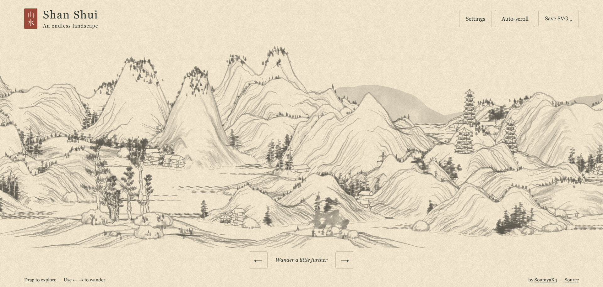

# Sơn Thủy Vô Tận · East Asian Procedural Live Wallpaper (.EXE)

Một bức tranh sơn thủy phong cảnh Á Đông vô tận được sinh tự động bằng các mô hình toán học (Spline bậc 3, đa thức Bézier, vi phân RK4, topo tính toán TDA Betti, phân rã POD) hiển thị trực tiếp thành hình nền động Native cho Windows 10/11.



---

## Tính năng chính

- **Hình nền động Windows Native:** Tích hợp trực tiếp dưới icon màn hình chính (Desktop WorkerW) qua Win32 API.
- **Tiết kiệm tài nguyên tối đa (Eco Power Saver):** Tự động phát hiện khi chạy ứng dụng Fullscreen/Game để tạm dừng (hạ CPU/GPU về 0%).
- **Kiến trúc 2 tầng (Two-Tier Pipeline):** Vòng lặp render 60–120 FPS mượt mà trên Render Loop chính và Web Worker ngầm sinh chunk không gây giật lag.
- **Khay hệ thống (System Tray):** Cho phép Tạm dừng/Tiếp tục, đổi hạt giống (Seed), chỉnh tốc độ cuộn ngay góc màn hình.
- **Tùy chọn tăng tốc NPU:** Hỗ trợ WebNN / DirectML Tensor Offload.

---

## Tải xuống & Cài đặt (.EXE)

Các phiên bản phát hành chính thức sẵn sàng tải về trong mục **[GitHub Releases](../../releases)**:

1. Tải file **`EastAsianWallpaper-win-x64.zip`** (hoặc file thực thi độc lập **`EastAsianWallpaper.exe`**) từ phiên bản mới nhất.
2. Giải nén thư mục và chạy file **`EastAsianWallpaper.exe`**.
3. Ứng dụng sẽ tự động khởi tạo hình nền động trên màn hình chính và hiển thị icon trong khay hệ thống (System Tray).

---

## Hướng dẫn Biên dịch từ Mã nguồn

### Yêu cầu môi trường:
- Windows 10/11 (x64)
- [.NET 8.0 SDK](https://dotnet.microsoft.com/download/dotnet/8.0)
- Microsoft Edge WebView2 Runtime (thường đã tích hợp sẵn trên Windows 10/11)

### Lệnh biên dịch:
```bash
# Đóng gói bản phát hành tự chứa đầy đủ (Self-Contained Single File)
dotnet publish src-win32/EastAsianWallpaper.csproj -c Release -r win-x64 --self-contained true -p:PublishSingleFile=true -p:IncludeNativeLibrariesForSelfExtract=true -o publish/
```

File thực thi `.exe` và tài nguyên `src-web/` sẽ được xuất vào thư mục `publish/`.

---

## Cấu trúc Dự án

```text
shan-shui-infinite-master/
├── .github/workflows/         # CI/CD tự động build và upload .exe lên GitHub Releases
├── src-web/                   # Web Rendering Engine & Toán học
│   ├── index.html             # Khung hiển thị SVG & Bộ lọc giấy dó
│   ├── main.js                # Render Loop & dọn rác DOM
│   ├── worker.js              # Background Web Worker sinh chunk
│   ├── math/                  # Các module toán: Spline, Bézier, RK4, TDA, POD, Armijo
│   └── generators/            # Sinh địa hình Karst, cây tùng bách, thuyền nan
└── src-win32/                 # Ứng dụng native C# .NET 8 WinForms & Win32 Interop
    ├── EastAsianWallpaper.csproj
    ├── Program.cs             # Điểm vào ứng dụng & System Tray Icon
    ├── WallpaperForm.cs       # Form không viền gắn vào WorkerW
    ├── WorkerWHelper.cs       # P/Invoke Win32 tìm cửa sổ WorkerW
    └── PowerManager.cs        # Quản lý điện năng & Fullscreen auto-pause
```

---

## Bản quyền & Ghi công

- Thuật toán gốc dựa trên tác phẩm phong cảnh sơn thủy của [Lingdong Huang](https://github.com/LingDong-/shan-shui-inf).
- Phát triển thành Native Windows Live Wallpaper (.EXE) với các cải tiến mô hình toán và tự động hóa.
- Mã nguồn phát hành theo giấy phép [MIT License](LICENSE).
